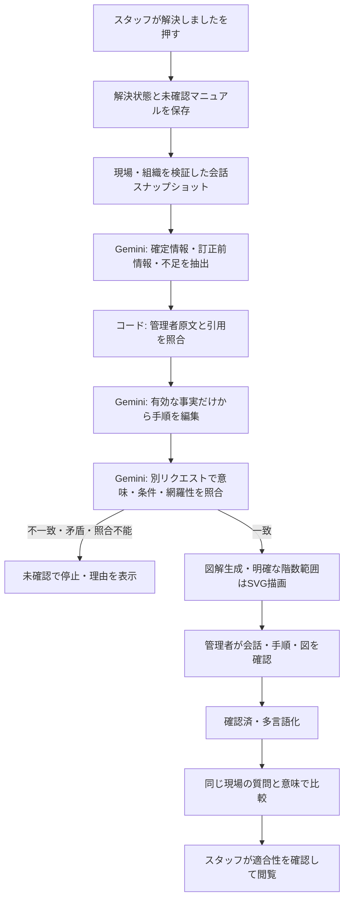

# Bridge Work：会話から、根拠のある現場マニュアルへ

## ピッチの主張

「現場で解決した一度の会話を、管理者が確認できる図解と、次のスタッフが使える多言語の知識に変えます。」

技術の狙いは、生成の回数を増やすことではなく、現場ごとの条件を失わず、間違った手順の再利用を防ぐことです。AIが正しいと断言する仕組みではありません。原文を追跡できる形に整理し、人が確認する範囲を明確にします。

## 今回実装した処理

- 事実抽出、編集、独立照合に、それぞれ役割とJSON Schemaを指定。Zodで返却値を検査します。固定したルールをsystemInstructionへ、会話をJSONデータへ分離します。
- 抽出する情報をaction / scope / condition / cautionに区別し、訂正前の情報をsupersededとして除外します。未解決の矛盾は自動的に補完しません。
- 原文の引用が実在するかはコードで検査します。その引用が意味を裏づけるかは別のGemini呼び出しで検査します。同じモデルによる照合なので誤りは相関し得ます。最終承認は管理者です。
- 図解モデルへ渡すのは照合後の手順だけです。範囲が明確な階段図は数値から描画し、未知の階数を画像モデルに想像させません。画像自体の自動的な意味検証は未実装で、人が確認します。
- 生成試行IDと保存バージョンを照合し、古い生成結果による上書きを防ぎます。解決操作は生成完了を待ちません。

実装：`lib/manual-pipeline.ts`（プロンプト・スキーマ・コンテキスト）、`lib/manuals.ts`（段階処理）、`lib/workflow.ts`（承認と公開）、`app/manual.tsx`（確認画面）。

## コンテキストの管理

| 管理対象 | 方針 |
| --- | --- |
| 参照範囲 | 認証後の同一組織・現場の対象相談1件。別の相談や未確認ナレッジは混ぜない |
| 信頼する情報 | 管理者の原文。スタッフ発言・参考翻訳・解決メモを作業ルールの根拠にしない |
| 順序 | メッセージ順と日時を保持。訂正と条件を考慮する |
| 上限 | 最大50発言・JSON 100,000 bytes。超過時に黙って切り捨てず停止する |
| 再現性 | 会話JSONのSHA-256、プロンプト版、指定モデル名、プロバイダー、件数、照合結果を保存 |
| 情報の最小化 | 氏名・送信者UIDは生成コンテキストへ含めない。本文に書かれた個人情報の自動マスキングは未実装 |
| 表示権限 | 引用と生成診断は管理者用。スタッフ向けレスポンスから除外する |
| 編集後 | AI照合済みという表示を外す。手順変更時は画像も無効化する |

会話本文は相談レコードに残し、生成履歴へ重複保存しません。SHA-256は内容の変更を検知する識別子であり、完全な再現を保証するものではありません。将来相談を編集可能にする場合は、元のスナップショットの保存も必要です。

短い会話には現時点で明示的なContext Cacheを作りません。コンテキスト管理とキャッシュは別の課題です。長い共通現場ルールを繰り返し参照する段階で、現場・ルール版・保持期間を分離してキャッシュを検討します。

## Google Cloudで動かす本番構成

| 技術 | 担う役割 | 現在の状態 |
| --- | --- | --- |
| Gemini / Vertex AI | 確定情報抽出、編集、照合、図解、翻訳、意味比較 | 呼び出しコードあり。今回の実サービス実行は保留、モックで段階処理を検証 |
| Firebase Authentication | スタッフと管理者の識別 | IDトークン検証コードあり。本番プロジェクトの接続・ユーザー作成は未完了 |
| Cloud Firestore | 会話、マニュアル、承認、閲覧した版を保存 | トランザクション実装あり。現在のプレビューはローカルJSON |
| Cloud Run | Next.jsと生成ワーカーの実行 | 推奨する配置先。未デプロイ |
| Cloud Tasks | 長い生成処理の永続キュー・再試行 | 次に実装する本番化項目。現在はNext.js afterで実行 |
| Cloud Storage | 生成画像を保存・版ごとに管理 | 次の本番化項目。現在は容量を制限した画像をマニュアルに保持 |
| Cloud Logging | 生成ステージ・遅延・失敗率の記録 | 次の本番化項目。会話本文やキーをログに出さない設計とする |

Cloud Runでは実行サービスアカウントのADCを使う認証経路を実装済みです。`GEMINI_PROVIDER=vertex`、`GEMINI_VERTEX_AUTH=adc`、`GOOGLE_CLOUD_PROJECT`を指定します。IAM、ADC、本番サービスの接続検証は別途必要です。今回キー発行や請求設定は変更していません。

Firestoreでは解決と未確認マニュアル作成を同じトランザクションで行います。Cloud Tasks導入時は、この同じトランザクション内でジョブのoutboxも保存し、別の処理でenqueueします。DB保存後のenqueue失敗による生成漏れを防ぐためです。ワーカーは試行IDで冪等にし、各ステージの結果を保存して再開できる構成にします。現時点ではプロセス停止時の自動再開はなく、管理者による再生成が必要です。

## プロンプトと評価

プロンプトは`bridge-manual-v2.0`としてコード管理し、役割・根拠・禁止事項・欠落時の動作・例を固定します。自由な文章を受け取るだけの方式にせず、モデル間の受け渡しは検査したJSONに限定します。

今回のテストでは、引用の捏造、実在する引用による意味の不一致、未解決矛盾、条件を保持しない照合結果、照合項目の欠落・重複、他現場コンテキスト、上限超過、スタッフへの診断情報漏えい、編集後の画像無効化を検証します。Geminiをモックしているため、これは制御の正しさの検証であり、実モデルの精度の測定ではありません。

API接続後の評価は、同じ質問を3言語、単純回答・訂正・例外・禁止事項・矛盾・情報不足・悪意ある入力に分けて行います。数量条件の保持率、根拠のない記述率、重要な注意の欠落率、止めるべきケースの停止率、生成時間、管理者の修正回数を記録します。未測定の数字をピッチで精度として提示しません。

## 90秒デモ

1. ベトナム語で「階段は何階まで？」と相談し、管理者が「1〜5階」、続いて「訂正、1〜3階、踊り場も」と回答する。
2. スタッフが解決を押す。管理者画面で抽出→編集→照合→図解の進行を見せる。
3. 確定情報と訂正前情報の件数、手順から原文へのリンク、1〜3階の図を見せる。
4. 管理者が確認して公開。別のスタッフが英語で質問し、適合性を確認して同じ図解を使う。
5. 「一度の解決が、言葉を越えて次の人の解決になる」で締める。

実サービスの動作確認後にこの一連を録画します。API停止を隠して成功に見せるデモは作らず、モックのデモ映像は検証用として区別します。

## 公式資料

- [Vertex AI 構造化出力](https://docs.cloud.google.com/vertex-ai/generative-ai/docs/multimodal/control-generated-output)
- [Firestore トランザクション](https://firebase.google.com/docs/firestore/manage-data/transactions)
- [Cloud Tasks と Firebase Functions](https://firebase.google.com/docs/functions/task-functions)
- [Vertex AI Context Caching](https://cloud.google.com/blog/products/ai-machine-learning/vertex-ai-context-caching)
